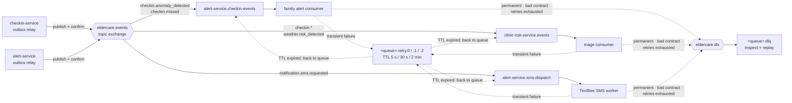

# Messaging: RabbitMQ middleware (v2 · Batch 1)

Course link: Topic 12 *Middleware and Integration Services* (message-oriented middleware, ACK, durability,
DLQ, idempotency, sagas) and Topic 11 *EAI* (publish–subscribe, idempotent receiver, dead letter channel).
Professor's evaluation: Section 15 must define **message payload schemas, Dead-Letter Queues and worker
idempotency** (replacing the BullMQ/Redis + Twilio design).

## 1. Why messaging here (and not everywhere)

| Interaction | Style | Reason |
|---|---|---|
| Caregiver submits a check-in | synchronous REST (`201`) | caregiver needs the stored result and anomaly list now |
| Check-in → family alert, clinic triage | **asynchronous event** | family SMS and clinic triage can happen a moment later; an Alert/Clinic outage must not fail the check-in |
| Weather hazard → clinic triage | **asynchronous event** | preventive, not blocking |
| Alert → SMS to each family member | **work queue** | one Android phone sends ~1 SMS/s; failures need retry without blocking the alert |
| Clinic → legacy EMR history | synchronous SOAP via adapter | nurse is waiting for the history on screen |

## 2. Topology



Every service declares the same topology idempotently on start-up (`shared/messageBus.js`):
durable exchanges and queues, persistent messages, **publisher confirms**, manual **ACK after the local DB
commit**, and a per-consumer **prefetch**.

| Queue | Bindings | Consumer | Prefetch |
|---|---|---|---|
| `alert-service.checkin-events` | `checkin.anomaly_detected`, `checkin.missed` | family alert | 10 |
| `alert-service.sms-dispatch` | `notification.sms.requested` | TextBee SMS worker | 1 |
| `clinic-risk-service.events` | `checkin.anomaly_detected`, `checkin.missed`, `checkin.normal`, `weather.risk_detected` | triage queue | 10 |

## 3. Event catalogue (JSON Schemas in `contracts/events/`)

Every event shares an envelope: `eventId` (UUID, idempotency key), `type` (= routing key), `schemaVersion`,
`occurredAt` (ISO-8601), `source`, optional `correlationId`. Producers validate before publishing; consumers
validate before processing – a contract violation goes straight to the DLQ (`x-death-reason: schema_invalid`).

| Event | Producer | Consumers | Key fields |
|---|---|---|---|
| `checkin.anomaly_detected` | checkin | alert, clinic | `patient`, `checkin`, `anomalies[]`, `severity`, `severityScore` |
| `checkin.normal` | checkin | clinic | `patient`, `checkin` (de-escalates an open case) |
| `checkin.missed` | checkin | alert, clinic | `patient`, `lastCheckinAt`, `severity` |
| `weather.risk_detected` | alert (mashup) | clinic | `patient`, `environment{hazard, heatIndexC, windMs, level, reasons}` |
| `notification.sms.requested` | alert | alert (SMS worker) | `notificationId`, `recipientPhone`, `alertType`, `payload{patientId, heatIndex}` |

SMS dispatch event (the evaluation's suggested shape, extended with the idempotency key and the text):

```json
{
  "eventId": "6d1f0c8e-5f7a-4f0e-9a51-3c7d1e2b9a10",
  "type": "notification.sms.requested",
  "schemaVersion": 1,
  "occurredAt": "2026-09-02T12:20:00Z",
  "source": "alert-service",
  "notificationId": "1b2c3d4e-0000-4000-8000-000000000001",
  "alertId": "a1b2c3d4-0000-4000-8000-000000000002",
  "recipientPhone": "+639170000000",
  "timestamp": "2026-09-02T12:20:00Z",
  "alertType": "HEATWAVE_DEHYDRATION_WARNING",
  "severity": "high",
  "message": "[ElderCare Connect] HEAT WARNING for Lola Remedios: heat index 41.5C ...",
  "payload": { "patientId": "P-1029", "heatIndex": 41.5 }
}
```

Dead-letter shape (`contracts/events/dead-letter.schema.json`): the original body unchanged, plus headers
`x-death-reason` (`schema_invalid | permanent_error | max_retries_exceeded | ambiguous_delivery | malformed_json`),
`x-error`, `x-original-routing-key`, `x-original-queue`, `x-attempts`, `x-failed-at`.

## 4. Reliability guarantees

| Risk | Control | Where |
|---|---|---|
| Check-in saved but event lost | **Transactional outbox**: event row written in the same transaction; relay marks it delivered only after the broker's publisher confirm | `shared/outboxRelay.js` |
| Broker down | outbox rows stay `pending`, exponential backoff, `failed` after 10 attempts (visible in `/api/admin/messaging`) | outbox |
| Consumer down | durable queue buffers; drains on restart | RabbitMQ |
| Duplicate delivery (at-least-once) | **Idempotent receiver**: `eventId` inserted into `processed_events` in the same transaction as the business change | `shared/idempotency.js`, clinic `upsertQueueItem` |
| Poison message | classified failure: permanent / contract errors → DLQ immediately, transient → 3 retry tiers → DLQ | `shared/messageBus.js` |
| Duplicate SMS on TextBee/carrier timeout | **SMS worker state machine** on `notificationId`: atomic claim `queued → sending`; terminal states never resend; a timeout after the request left → `unconfirmed` + DLQ for an operator to check the phone before replaying | `services/alert-service/src/smsWorker.js` |
| Phone overload / quota | prefetch 1, ≥ 1 s between sends, `SMS_DAILY_LIMIT` | SMS worker |

## 5. Operating it

- RabbitMQ UI: <http://localhost:15672> (vhost `eldercare`) – queue depths, DLQ contents, consumers.
- `GET /api/admin/messaging` (admin JWT) – broker status, queue and DLQ depths, outbox counts per service.
- `POST /api/admin/messaging/replay` `{ "service": "alert", "queue": "alert-service.sms-dispatch", "limit": 10 }` –
  after fixing the cause, moves parked messages back into **that** queue only. A replayed SMS that was
  `failed` / `unconfirmed` is sent at most once more.
- No broker (laptop without Docker): `EVENT_TRANSPORT=http` keeps the v1 direct REST delivery; the SMS queue
  runs in-process with the same retry/DLQ rules.

## 6. Tests

`services/alert-service/test/messaging.test.js` (routing, retry tiers, DLQ + replay, contracts) and
`test/smsWorker.test.js` (no duplicate SMS on redelivery, timeout, crashed worker, replay). They run against the
in-process transport, which applies the same rules as the RabbitMQ topology.
